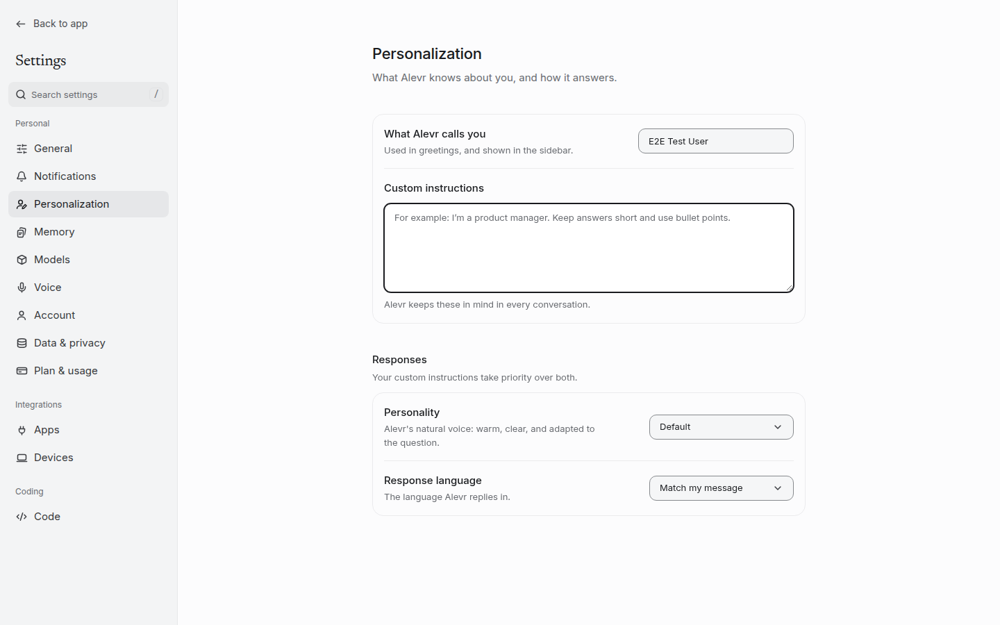
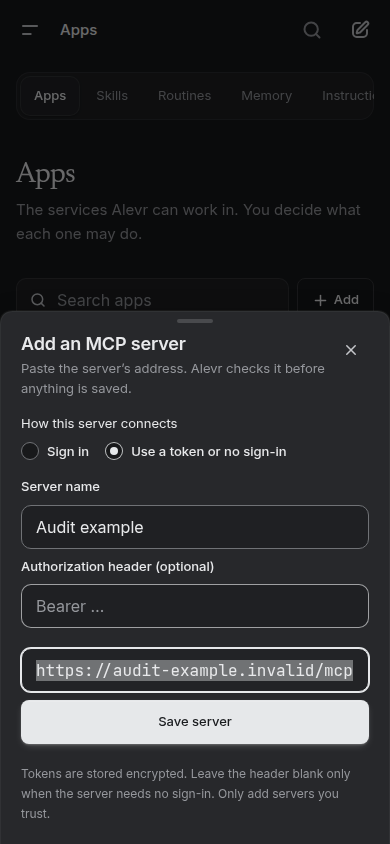

# One identity across web, Mac, and iPhone

**Owner request, 29 October 2026:** improve the overall design identity,
components, UI/UX, and motion; make the website more impressive and uniform; and
bring macOS/iOS to the same identity and quality standard.

## Direction

The current shipped palette is graphite on near-white/near-black grounds, with
ultramarine reserved for live activity. Several older design documents still
describe warm paper and coral. The current canonical tokens, brand display-name
module, and later decisions take precedence over that historical prose.

The design pass strengthens the existing identity: clear type hierarchy, crisp
shared controls, consistent geometric corners, readable states, and short
purposeful motion. The reading column stays calm. Floating layers have a clear
edge and shadow; motion explains state and spatial continuity. The same state
should look and move like the same state wherever a user encounters it.

This is a design-system implementation and core-interaction pass. It is not a
claim that every bespoke screen has been re-rendered, nor a substitute for
Apple device review. No vendor artwork or new product name was introduced.

## Canonical sources and component mapping

| Concern | Source of truth | Web consumers | Native consumers |
|---|---|---|---|
| Color and state | [globals.css](../../src/app/globals.css) | CSS variables and Tailwind semantic colors | Generated `JunoGeneratedColors` pairs |
| Radius/type/spacing | [tailwind.config.ts](../../tailwind.config.ts) | Named utility rungs | Generated radius/type/spacing ladders |
| Spring timing | `--spring-*-params` in globals | [motion.ts](../../src/lib/motion.ts) and generated CSS easing twins | `JunoMotion` using generated spring values |
| Form fields | Six `--field-*` roles | [field-recipe.ts](../../src/components/ui/field-recipe.ts), Input/Textarea/Select | [JunoFieldSurface.swift](../../native/Packages/JunoNativeKit/Sources/JunoDesignSystem/JunoFieldSurface.swift) |
| Press feedback | Shared press/fast timing and selected fill | [control-recipe.ts](../../src/components/ui/control-recipe.ts), Button/IconButton/Pressable | `JunoPressButtonStyle` |
| Composer geometry | Generated composer radius; common control state rules | ComposerShell and chat Composer | Mac ChatComposer and iOS JunoMobileComposer |
| Tooltip intent | Generated 200ms intent / 400ms peer window | TooltipProvider defaults | Generated timing table for native consumers |

`npm run design:tokens` projects the hand-authored web values to TypeScript and
Swift, including four color appearances. `npm run design:tokens:check` detects
drift. `design:contract` is a separate artifact-document schema generator; it
does not govern these UI tokens.

## Shared field material

Previously Input, Textarea, and Select restated their own alpha values and focus
rules. Select mixed a material class with border overrides and a large focus
halo; Textarea used another hover edge. Native forms independently drew still
other surfaces.

The shared ladder is now explicit:

| State | Role | Behavior |
|---|---|---|
| Rest | `field-surface` + `field-border` | Muted surface and an identifiable input edge. |
| Hover | `field-hover` | Stronger graphite edge without changing geometry. |
| Focus | `field-surface-active` + `field-focus` | Active surface and stronger edge. |
| Keyboard focus | `field-ring` | A clear continuous focus indicator, respecting platform focus conventions. |
| Invalid (web) | Existing destructive role | Error remains legible through hover/focus; semantics still come from the field. Native invalid-field presentation remains a separate follow-up. |
| Disabled | Shared disabled behavior | No misleading press/hover motion; retain readable content. |
| Increased contrast | Full ring edges | Light/dark high-contrast appearances are generated with the same rules. |

The measured regression checks every field edge against both field surfaces in
light, dark, and both high-contrast appearances (at least 3:1). Foreground and
placeholder text retain 4.5:1, or 7:1 under increased contrast. These are token
measurements, not a blanket WCAG certification of every product screen.

Text fields and selects share their touch height. Native adoption covers real
search, rename, model selection, and instructions consumers through a common
modifier. System-owned search/navigation controls keep platform conventions.
The real phone layouts also retain a 44px connection-address input and the
instructions page's larger 128px writing area; responsive flex and shared field
rules no longer collapse those caller-owned dimensions.

## Motion that agrees across implementations

### Generated springs now reach the actual web presets

The repository already generated CSS and Swift spring values, but
`src/lib/motion.ts` still recreated several values by hand. It also passed
Motion's `duration`, which means a total duration, where the contract defines
`visualDuration`, the time for the main movement to appear to settle. The
standard web preset omitted the shared small bounce.

Web presets now consume the generated `visualDuration` and `bounce` directly,
so segmented controls, tabs, composer movement, and relevant layout transitions
use the same authored family as SwiftUI. The physically parameterized
gesture-following spring remains a separate deliberate preset. See Motion's
[transition documentation](https://motion.dev/docs/react-transitions) for the
distinction between physical, duration, and visual-duration springs.

### State remains visible with reduced motion

Reduced motion removes scale/travel while retaining useful color/opacity
feedback. Shared web press recipes no longer indiscriminately drop every
transition. Native send/voice/stop swaps previously kept scale changes even
under Reduce Motion because their animation had been classified as a tint.
The native swap now resolves both the animation and the transform from the
user's motion/cross-fade preference.

No new idle animation loop, animated blur, always-running shader, or animation
dependency is added. Menus and panels retain their existing focus/cancellation
semantics. The small interactive-card lift is consistent and limited to fine
pointer interaction; reduced motion keeps tonal feedback.

### Floating layers and tooltips

Popover sizing respects the available viewport and scroll containment. The
modal scrim no longer applies a backdrop filter across the whole underlying
application. Mobile sheet corners read the shared panel radius. Tooltip intent
and the peer-skip window read the canonical tokens, preserving the existing
application's 200ms/400ms responsiveness. Long tooltip labels can wrap rather
than being clipped.

## Native identity and usability

iOS had a separate pure-white/pure-black neutral set, plus independent cards,
muted grounds, bubbles, and borders. Replacing just the canvas would have left
the rest of its hierarchy mismatched. The related neutral roles now resolve
from the same generated palette as the web/Mac, including high contrast.
Native sheets, menus, safe areas, and navigation remain native behaviors.

Both native composers read the generated composer radius instead of their own
hardcoded corner. The primary action gets the shared press treatment; its
send/voice/stop state swap respects accessibility preferences. The phone's
thinking control uses a 44pt target. Shared phone card/chip/chrome presses use
one cadence rather than independent styles with subtly different feedback.

The embedded design editor also had an independent older palette. Its bundle
builder now projects the canonical custom properties in all four appearances
and the narrow set of shared button, menu, and tooltip surface rules it uses.
The CSS scan and bundle fingerprint include the shared field/control/menu
recipes, theme, motion, and build script. This fixes missing field variables
and prevents a changed shared primitive from leaving the offline native bundle
quietly stale. Compiled-CSS regression checks cover the shipped output.

Static checks and source tests can verify use of the common tokens and policies.
They cannot verify actual iPhone keyboard transitions, Dynamic Type wrapping,
VoiceOver, macOS focus rings, or smoothness on hardware. Apple SDK build and
device/snapshot gates remain part of release acceptance.

## Interaction craft beyond styling

The composer now owns a send synchronously before awaiting preparation, so
double Enter cannot create duplicate pending submissions. Draft state survives
the landing-to-dock mount change through a view-local session. Text and
attachments/quotes/modes have separate ownership checks so accepting one send
does not erase newer work or resend already accepted resources accidentally.
Private draft state stays in memory.

Attachment lifetime has one remaining boundary: new uploads added during the
first message's preflight can still be lost when the landing Composer remounts
in the dock. The shared session owns text and context chips; upload ownership
is still component-local. That existing issue needs a separate handoff fix and
must not be confused with the implemented cleanup of submitted upload IDs.

Find-in-conversation shows a readable highlighted preview, exact versus capped
counts, and which history has actually loaded. Selection stays on the same hit
when older messages arrive. Unicode matching preserves original offsets.
Escape closes the find bar without also stopping generation, and focus returns
to its opener when appropriate.

Delayed welcome/composer autofocus now yields to a newer user interaction.
Only an actual New chat control may hand off its focus on arrival; other
sidebar controls keep theirs. This corrects the timing race where Search's
dialog could capture the composer as its opener after a queued autofocus ran.
Leaving incognito similarly returns focus to its privacy control without a
competing welcome-screen request.

These are the small interactions that make an interface feel dependable. They
improve the experience without adding another control row or another model call.

## Captured browser evidence

The final production-browser suite passed all 21 selected checks. These images
come from that run, using the disposable QA account and fake provider. The
phone images show the responsive website in Chromium; they are not native app
screenshots. [Validation](VALIDATION.md) records the motion, contrast, keyboard,
and geometry checks that static images cannot demonstrate. Capture paths,
dimensions and hashes are retained in [the evidence index](screenshots/evidence.json).

### Desktop fields and focused writing area

### Phone dialog and consistent touch fields

Additional captures:

- [Desktop select at the last keyboard-reachable option](screenshots/desktop-light-settings-select.png)
- [Phone instructions retaining the larger writing area](screenshots/phone-dark-settings-fields.png)
- [Conversation Find with a highlighted context preview](screenshots/find-context-preview.png)
- [A newer incognito draft retained during acceptance, with reduced motion](screenshots/composer-pending-draft-reduce.png)

## Continuing the consistency work

The shared component families reach many screens, but bespoke feature surfaces
still need migration and visual review. When touching one, use the shared
field/control/surface/motion recipes, avoid raw neutral colors and private
timings, and verify the real light/dark/keyboard/touch states. Do not mask drift
by updating an exception baseline until the change is understood.

The final validation record includes executed checks and browser evidence.
Native runtime review and production performance comparison remain explicit
release tasks, not implied by a passing token generator.
